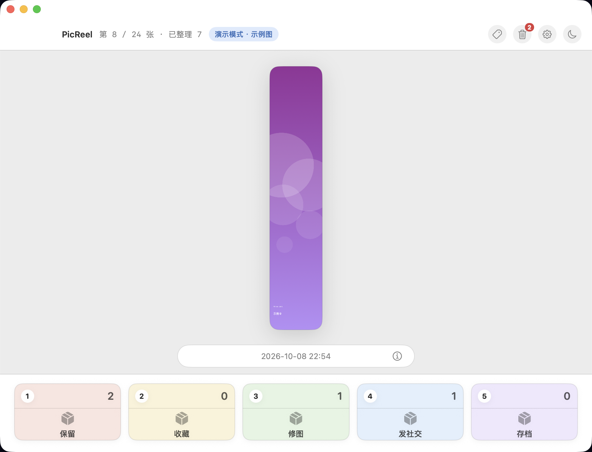

<h1 align="center">PicReel</h1>

A macOS/Android app lets you organize your photo with one finger.

## Introduction

一款通过Vibe Coding开发的相册整理工具。
操作逻辑类似SlideBox，并对键盘操作进行了优化。

## Features

- 一键整理，只需要一个按键即可执行分类、删除操作。
- 体积小巧，纯本地运行，足够安全。
- Shuffle模式，随机挑选20张照片进行整理。
- 成就功能，庆祝你的每一个整理里程碑。

## Screenshots

## Download

Download the latest version from
[GitHub Releases](../../releases/latest).

## Installation

Download the appropriate package for your operating system
and follow the installation instructions.

## Feedback

If you encounter a bug or have a feature request,
please open an [Issue](../../issues).

## License

See the LICENSE file for details.
